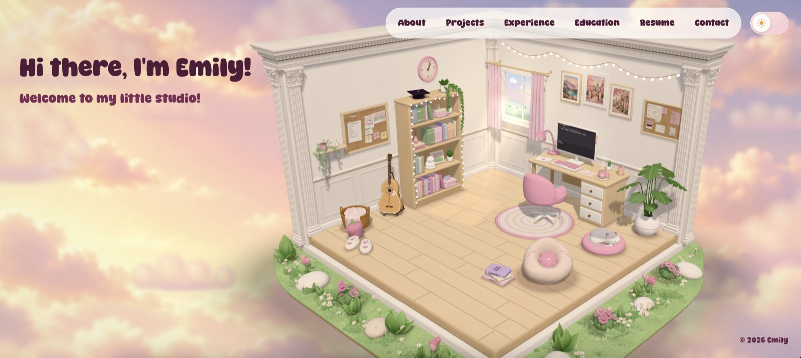
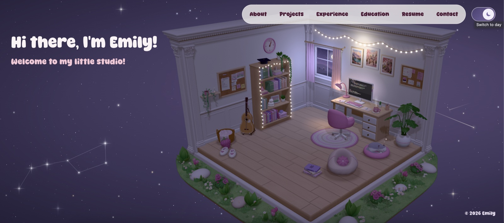

# Emily's Studio

Welcome to my little studio! Come visit at **[emilyzzzhang.github.io](https://emilyzzzhang.github.io)**.

  
  

I've always loved working on things that are both technical and creative, so I built my
portfolio as a tiny 3D room using React and Three.js. Everything in it is made in code, from the
furniture to the flowers in the garden outside.

## Look around

Feel free to click on things! Each one opens a different part of the portfolio:

- **Computer**: my projects
- **Coffee mug**: a bit about me
- **Bookshelf**: my education
- **Picture frames**: my experience
- **Cork board**: my résumé
- **Envelope**: how to reach me

## Little extras

- **Mochi**: my cat, usually sleeping in her bed. You can try waking her up :))
- **Guitar**: click it to play a little tune
- **Night mode**: the sky fills up with stars, and if you wait a little you might catch a shooting star
